# NetaMonitor Logical Data Model

**Phase:** PH-00 · **Version:** 0.1 · **Status:** Draft for human review
**Decision owner:** Human project owner · **Not a migration or physical schema**

## 1. Modeling and classification rules

This logical model is a starting point for PH-01+ design. It does not choose a legal basis, provider, retention duration, deployment topology, or final database constraints. PostgreSQL is a proposed relational target; field types and SQL are intentionally omitted.

Classification:

- **PUBLIC:** intended for public display after editorial review and publication.
- **INTERNAL:** workflow/business metadata, staff-only.
- **PERSONAL:** account/user data; purpose-limited and access-controlled.
- **RESTRICTED:** identity/constituency evidence, security credentials, vote-linkage or sensitive incident material; tightly separated and never public.
- **DERIVED:** calculated/aggregated values; classification follows source sensitivity and disclosure risk.

For each retained object record: stable identifier; created/recorded time; effective interval if applicable; provenance/source references; actor/reviewer; lifecycle state; classification; retention-policy identifier; and revision/supersession link. **Retention durations and legal holds are open gates (Q03); “delete” must be designed to cover replicas, caches, exports and backup expiry, subject to legal review.**

## 2. Logical ERD

```mermaid
erDiagram
  PERSON ||--o{ CANDIDACY : contests
  PERSON ||--o{ OFFICE_TERM : serves
  OFFICE_TYPE ||--o{ OFFICE_TERM : classifies
  CONSTITUENCY ||--o{ OFFICE_TERM : represents
  CONSTITUENCY ||--o{ BOUNDARY_VERSION : has
  ELECTION_EVENT ||--o{ CANDIDACY : includes
  CANDIDACY ||--o| ELECTION_RESULT : yields
  PERSON ||--o{ PARTY_MEMBERSHIP : has_history
  POLITICAL_PARTY ||--o{ PARTY_MEMBERSHIP : membership
  PERSON ||--o{ PROMISE : makes_or_owns
  OFFICE_TERM o|--o{ PROMISE : campaign_or_term_context
  PROMISE ||--o{ RESPONSIBILITY_LINK : attributed_to
  PROMISE ||--o{ MILESTONE : tracks
  PROMISE ||--o{ PROMISE_EVIDENCE : supported_by
  EVIDENCE ||--o{ PROMISE_EVIDENCE : relates
  EVIDENCE ||--o{ EVIDENCE_SOURCE : cites
  SOURCE ||--o{ EVIDENCE_SOURCE : cited_by
  PROMISE ||--o{ ADJUDICATION : assessed_by
  PERSON ||--o{ FINANCIAL_DISCLOSURE : discloses
  FINANCIAL_DISCLOSURE ||--o{ DISCLOSURE_ITEM : contains
  PERSON ||--o{ AFFILIATION : related
  ORGANISATION ||--o{ AFFILIATION : relates
  ACCOUNT ||--o{ VERIFICATION_CASE : applies
  VERIFICATION_CASE ||--o{ VERIFICATION_EVIDENCE : holds_restricted
  ACCOUNT ||--o{ ELIGIBILITY_RECORD : eligibility
  PROMISE ||--o{ EVALUATION : receives
  EVALUATION_SUBJECT ||--o{ EVALUATION : opaque_subject
  ACCOUNT ||--o{ EVALUATION_SUBJECT : restricted_mapping
  EVALUATION ||--o{ EVALUATION_REVISION : revisions
  PROMISE ||--o{ AGGREGATE_SNAPSHOT : disclosed_as
  PUBLIC_RECORD ||--o{ RECORD_VERSION : versions
  SOURCE ||--o{ SOURCE_SNAPSHOT : captured_as
  REVIEW_CASE ||--o{ REVIEW_DECISION : resolved_by
  PUBLIC_RECORD ||--o{ CORRECTION_REQUEST : corrected_through
  PUBLIC_RECORD ||--o{ RIGHT_OF_REPLY : receives_reply
  REVIEW_DECISION ||--o{ APPEAL : may_be_appealed
  ACCOUNT ||--o{ SUBMISSION : submits
  SUBMISSION ||--o{ MODERATION_CASE : moderated_by
  ACCOUNT ||--o{ PERMISSION_GRANT : assigned
  AUDIT_EVENT }o--|| ACCOUNT : actor_if_known
  IMPORT_JOB }o--|| SOURCE : imports_from
```

`PUBLIC_RECORD`, `EVALUATION_SUBJECT`, and links crossing restricted contexts are logical concepts, not instructions to place sensitive data in a shared table or database. The `ACCOUNT`–`EVALUATION_SUBJECT` association exists only in the identity-mapping boundary; it is not a direct foreign key/join from the vote-choice records. Physical separation or an equivalently strong isolation boundary between voter identity mapping and vote-choice records is a HIGH-PRIORITY security decision that must be resolved and independently reviewed before any voting implementation (SEC-01/ADR-002). The ERD does not imply that a shared database with logical labels is approved.

## 3. Entity/data dictionary draft

| Entity | Key relationships / candidate attributes | Class | Lifecycle and retention note |
|---|---|---|---|
| Person | Stable public ID; display names/transliterations; identity-resolution references | PUBLIC/INTERNAL | Public identity claim is reviewed; correction versions retained. |
| OfficeType | Jurisdiction, level, title, authority definition | PUBLIC | Version taxonomy; exact coverage owned by PH-06/07. |
| Constituency | Type, parent unit, jurisdiction, codes | PUBLIC | Geographic fact with sources and temporal versioning. |
| BoundaryVersion | Constituency, valid-from/to, geometry reference, source, licence | PUBLIC/RESTRICTED as source terms require | Immutable version; source/media terms checked before publication. |
| ElectionEvent | Jurisdiction, office type, dates, source/status | PUBLIC | Event state/version; not a platform vote. |
| Candidacy / ElectionResult | Person, event, party, result, source and review | PUBLIC | Separate candidacy from result/term; correct by version. |
| OfficeTerm | Person, office type, constituency, election reference, effective interval, source | PUBLIC | Temporal history; never infer or overwrite overlapping records. |
| PartyMembership | Person, party, interval, confidence/source | PUBLIC | Effective dates and recorded dates; revisions retained. |
| Promise | Original text/language, person/term context, due rule, measurable criteria, state/version | PUBLIC | Publication/review/correction history. |
| ResponsibilityLink | Promise, person/office/agency, role, interval, basis/source | PUBLIC | Attribution review; shared responsibility explicit. |
| Milestone | Promise/project, criterion, due/observed date, state and source | PUBLIC | Append/update through versioned history. |
| Source / SourceSnapshot | Issuer/owner, jurisdiction, URL/reference, dates, licence/terms, retrieval/input hash | PUBLIC/INTERNAL | Store only permitted metadata/content; recheck source terms. |
| Evidence / PromiseEvidence | Evidence type, claim relevance, issuer, source links, submitted/review state | PUBLIC/INTERNAL | Unreviewed submissions are clearly labelled; restricted attachments separated. |
| Adjudication | Promise/evidence versions, decision, rationale, reviewer, confidence, methodology | PUBLIC/INTERNAL | Append-only decision version; own-work approval prohibited. |
| PublicProject / Scheme / Agency | Name, jurisdiction, authority, funds/source, dates, role links | PUBLIC | Prevent unsupported credit; source-backed versions. |
| FinancialDisclosure / DisclosureItem | Person, as-of/declaration date, scope, amount/unit, basis, source | PUBLIC, potentially sensitive | Only sourced public disclosure; legal/editorial review and correction path. |
| Organisation / Affiliation / PublicActivity | Entity type, relationship/participation label, dates, source, confidence | PUBLIC | No guilt-by-association; typed relationship and context. |
| SocialAccount | Public URL, platform identifier, claimant/source confidence, status | PUBLIC | Impersonation/claim review and platform terms; avoid private account data. |
| Account / ContactMethod | Provider-neutral subject, contact confirmation state, recovery metadata | PERSONAL/RESTRICTED | Provider credential data stays with auth provider; platform stores minimum reference. |
| ConsentRecord | Purpose, notice version, choice, time, withdrawal | PERSONAL | Retention and legally required record policy are open. |
| VerificationCase | Account reference, requested tier/constituency, state, reviewer, dates, reason codes | RESTRICTED | Reviewer separation, appeal, expiry; retention undecided (Q03). |
| VerificationEvidence | Evidence type/reference, minimal extracted facts, storage pointer, access log | RESTRICTED | Avoid retaining raw evidence if possible; encryption, deletion, backup expiry decision required. |
| EligibilityRecord | Account reference, constituency, basis/method category, valid interval, decision | RESTRICTED | Only minimum assertion needed for eligibility; no public residence exposure. |
| EvaluationSubject | Opaque subject/token reference; account-to-subject mapping held only in the separate identity-mapping boundary | RESTRICTED | Physical separation or equivalently strong isolation is a high-priority pre-voting decision; key custody and deletion/revocation policy require review. |
| Evaluation / EvaluationRevision | Promise, opaque subject, choice, time, active marker, revision reference; no direct account identifier | RESTRICTED | Choice records cannot resolve voter identity; at most one active choice proposed; isolation and auditability/privacy tension must be reviewed before voting implementation. |
| PrivateEvaluationConfirmation | Authenticated voter session reference and that voter's own submitted choice, presented only to that voter | RESTRICTED / private | Non-shareable and non-exportable; not public output, third-party proof or a result receipt. Never contains another voter's choice. |
| AggregateSnapshot | Promise/cohort/window, counts, suppression-policy version, computation version | DERIVED | Public results/aggregates are distinct from private confirmations; no publication until Q01; assess differencing and small cells. |
| PublicRecord / RecordVersion | Record type/ID, version, publication status, content hash, supersedes link | PUBLIC/INTERNAL | Append-only public history and correction notices; retention policy required. |
| ReviewCase / ReviewDecision | Subject/version, queue, role, reason, reviewer, outcome, timestamps | INTERNAL/PERSONAL | Least-privilege; decision appeal and separation. |
| CorrectionRequest / RightOfReply / Appeal | Record and decision refs, submitter, evidence, status, response and outcome | PERSONAL/INTERNAL; published outcome PUBLIC | Submitter identity protected; public response only after review. |
| Submission / Comment / ModerationCase | Account or anonymous reference, content, status, report/action and appeal | PERSONAL/INTERNAL; accepted content PUBLIC | Abuse/harassment data may be restricted; avoid indefinite retention. |
| PermissionGrant / AdminSession | Subject, permission, scope, grantor, expiry, MFA/reauth state | RESTRICTED | Review and revoke access; break-glass is time-limited and audited. |
| ImpersonationSession | True actor, target, reason, approval, start/end, denied actions | RESTRICTED | No vote/verification/role changes; access review and retention decision. |
| AuditEvent / IntegrityCheckpoint | Actor, action, target, reason, timestamp, prior hash/checkpoint | RESTRICTED/INTERNAL | Append-only application policy; external checkpoint and retention are proposed. |
| ImportJob / ImportReview | Source, input hash, mapping version, errors, reviewer, reconciliation result | INTERNAL | Repeatable, non-destructive; preserve source and import lineage. |
| Subscription / Notification | Account, target, consent/preferences, delivery status | PERSONAL | Provider-neutral; retention and channel consent reviewed. |
| ScoreSnapshot | Entity/cohort, method version, inputs, exclusions, result, computation time | DERIVED/PUBLIC | Reproducible, no manual override; recalc after correction as new version. |

## 4. Data lifecycle / access matrix

| Data class | Create/collect | Access | Public output | Retention/deletion gate |
|---|---|---|---|---|
| Public record/source | Editor/import under documented source terms | Public after review; staff edit by permission | Approved version and source attribution | Preserve version history under approved policy |
| Account/contact | User/provider auth flow | Account holder and minimal auth/support roles | None | Q03/legal; deletion, recovery and legal hold |
| Raw identity/constituency evidence | Verification process only if necessary | Designated verification role/service; audited | Never | Q03 must define immediate/limited deletion and backup expiry |
| Eligibility assertion | Approved review | Eligibility service and limited verifier | Never expose evidence or exact reason publicly | Expiry, revocation and minimised audit decision per Q03 |
| Vote subject mapping | Eligibility service | Identity-mapping boundary; no routine admin access | Never | SEC-01 boundary review before voting; Q03 retention, revocation, key rotation |
| Vote choice/revision | Eligible evaluation flow | Vote-choice boundary; no staff individual-choice view | No individual output | SEC-01 boundary review before voting; Q03 audit/deletion balance |
| Private voter confirmation | Successful authenticated submission | Only the voter in an authenticated, non-shareable/non-exportable view | Never public or third-party verifiable | D05; session/shared-device handling and Q03 |
| Public results/aggregates | Deterministic job from approved inputs | Public only after Q01 review/suppression; internal controls | Disclosure-safe aggregate only; never an individual receipt | Recompute/version; prevent differencing |
| Admin/security/audit | System and privileged actions | Restricted operators/auditors | No raw access data publicly | Retention and external checkpoint decision |

## 5. Constraints for future physical design

- Enforce immutable stable IDs and version references; include both valid-time and recorded-time where history matters.
- Enforce one active evaluation per opaque subject/promise only after approved eligibility semantics and threat review.
- Prevent a user from approving their own verification/content item; enforce at the service boundary and test database constraints where appropriate.
- Use explicit uniqueness, foreign-key and interval-overlap rules only after office/constituency temporal semantics are resolved.
- Public read models must be allowlisted projections, never broad serialization of restricted entities.
- No voting implementation may begin until SEC-01 resolves physical separation or an equivalently strong isolation boundary and independent security/privacy reviewers have reviewed the design and denial paths.
- A private voter confirmation contains only the authenticated voter's own submitted choice and is non-shareable/non-exportable. Public results are separately governed aggregates; no vote receipt is publicly published or verifiable by a third party.
- Object metadata must declare classification, owner, purpose, encryption, access policy, malware review where relevant and deletion state.
- Do not use database row-level security or a provider feature as the sole authorization boundary.
- A production schema/migration is outside PH-00.

## 6. Open decisions

Open: identity attributes and vendor, residence evidence, exact boundaries/source licensing, entity deduplication, Q01 aggregate threshold and anti-differencing policy, Q03 retention/deletion/legal basis, vote revision/audit retention, public response identity, data export/deletion scope, audit checkpoint operator, and financial sensitivity handling. Assigned owners and phases appear in [the open-decision register](./decisions/DEC-002-open-product-and-policy-questions.md).
