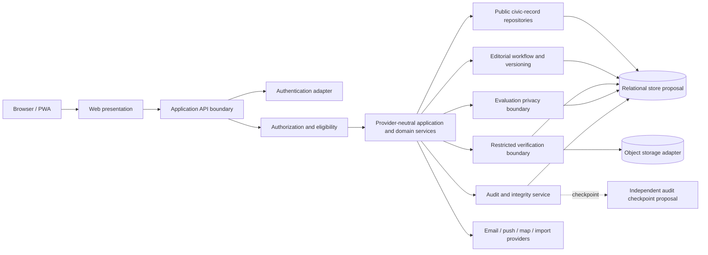

# NetaMonitor Proposed System Architecture

**Phase:** PH-00 · **Version:** 0.1 · **Status:** PROPOSED
**Decision owner:** Human project owner · **No stack/provider is accepted by this document**

## 1. Goals and constraints

Support sourced public records and workflows while preserving privacy, election neutrality, temporal history, accessibility and provider portability. Keep sensitive identity and evaluation data out of public presentation/API surfaces. PH-00 defines logical boundaries only; no runtime, endpoint, deployment or infrastructure is created.

## 2. Proposed logical components

Components are logical security/trust boundaries, not a commitment to microservices or separate physical databases. Before any voting implementation, the HIGH-PRIORITY SEC-01 decision must require physical separation, or establish an equivalently strong isolation boundary, between voter identity mapping and vote-choice records. The boundary, permitted cross-boundary operations, threat model, denial paths and independent security/privacy review must be complete first. The diagram does not approve co-location or logical separation alone. Raw verification evidence also requires a separate threat-informed isolation decision. Apply least privilege even if PH-01 selects a modular monolith.

## 3. Trust zones and request flow

1. **Untrusted client:** presentation, local public-cache allowlist and user input. No business authorization or privileged secret is trusted here.
2. **API edge:** request validation, session authentication, abuse controls, correlation IDs and rate limits. Errors do not expose hidden resources or private data.
3. **Application/domain:** permission and eligibility checks, use cases, transaction boundaries and policy decisions. Domain rules are provider-neutral.
4. **Public-record persistence:** sourced and versioned public information; never directly serializes restricted records.
5. **Restricted verification zone:** identity evidence/decisions with purpose-limited roles and separate storage/access policy.
6. **Evaluation privacy zone:** eligibility mapping and vote choice separated by a narrow service boundary; aggregate-only public projection.
7. **External adapters:** authentication, email/push, object storage, maps/geocoding, source/import, monitoring and hosting. Each has failure, data-processing and exit conditions.
8. **Operational/audit zone:** append-only application events, restricted access, integrity verification and independent checkpoint option.

Example evaluation flow: client obtains a session; API authenticates; eligibility service checks account/constituency/promise/staff/pause state; evaluation boundary accepts one explicit action with idempotency and records the opaque subject/choice across the SEC-01-reviewed isolation boundary. After successful submission, the authenticated voter may see a private, non-shareable and non-exportable confirmation showing only their own submitted choice; this is not a public result, third-party-verifiable receipt or coercive proof. Public results/aggregates are separate disclosure outputs and remain blocked on Q01. Exact collection, revision and retention rules remain subject to Q03.

## 4. Proposed technology baseline and alternatives

| Concern | Existing proposal | Boundary / alternative to evaluate |
|---|---|---|
| Web | React + TypeScript + Vite | Standard browser delivery; no security policy in frontend |
| API | Hono + TypeScript, initially Workers | HTTP/application interface independent of edge runtime |
| Data | PostgreSQL, initially Supabase hosted | Relational contract/migrations and export; provider-managed extensions must be replaceable |
| Authentication | Supabase Auth initially | Provider-neutral subject/session validation adapter; alternatives evaluated at PH-01 |
| Object storage | Cloudflare R2 | S3-compatible/object interface; portability, lifecycle and encryption test |
| Hosting | Cloudflare Pages/Workers | Standard build artifact/API contracts; document non-edge runtime path |
| API contract | OpenAPI proposal | Versioned, language-neutral public/internal contract with runtime validation |
| Test stack | Vitest, Playwright, axe-core | Select in PH-01 with portable clean-clone commands |

These are proposals from `AGENTS.md`/handbook, not vendor selection or procurement approval. No provider quotas, service tier, data location, legal adequacy, SLA or cost is guaranteed.

## 5. Architecture principles and interfaces

- Organize around domain/application interfaces; infrastructure adapters implement repository, identity, object, notification, map and import ports.
- Keep public API read models separate from write/workflow models and restricted projections.
- API operations authenticate and authorize server-side; validate requests and responses; enforce idempotency and abuse limits for sensitive actions.
- Use versioned, explicit contracts; do not make a UI capability label (including `ballot.*`) an endpoint specification.
- Public APIs allowlist fields, aggregate responses and rate limits; do not expose records by generic ORM serialization.
- Never return an individual vote receipt through public APIs or provide a shareable/exportable/third-party-verifiable receipt. Private confirmation and public aggregate output are distinct surfaces with separate authorization and disclosure rules.
- Domain events/outbox may be considered for reliable asynchronous notifications/imports, but implementation pattern awaits PH-01.
- Data imports are staged, hashed, mapped and reviewed; never silently overwrite temporal records.
- Offline caches include only allowlisted public content and show timestamp; never cache identity, admin, private account or individual evaluation data.

## 6. Portability, operations and failure behavior

Provider substitution requires adapter contract tests, export/import procedure, migration and rollback plan, credential rotation and documented data-processing implications. Avoid provider-specific business logic, proprietary schema types, undocumented triggers and opaque exports.

Before production, define backup encryption, frequency, restore drills, RPO/RTO, key ownership, retention/backup expiry, incident response, access review, quota/cost alerts, dependency monitoring and data export. No exact SLO or RTO/RPO is accepted in PH-00.

Failure behavior is fail-closed for authz, eligibility, verification, vote submission and privileged operations. No optimistic success UI for those operations. Public browsing may degrade to stale, previously cached public content with a freshness warning. Noncritical provider failures (notifications/maps) must not alter domain facts. Database/object-store/identity-provider outage must not silently lose a decision or publish partial sensitive data.

## 7. Proposed ADRs and dependencies

Architecture options remain PROPOSED; refer to [ADR-001](./adr/ADR-001-provider-neutral-modular-architecture.md), [ADR-002](./adr/ADR-002-sensitive-data-boundaries.md), [ADR-003](./adr/ADR-003-versioned-provenance-and-audit.md), and [ADR-004](./adr/ADR-004-contract-first-api.md). Human review is required before PH-01 commits to an implementation baseline.

## 8. Explicitly deferred

No concrete endpoints, OpenAPI file, SQL schema/migration, provider selection, region, account/identity vendor, key-management product, deployment topology, operational service level, data retention duration or production integration is selected in PH-00.
